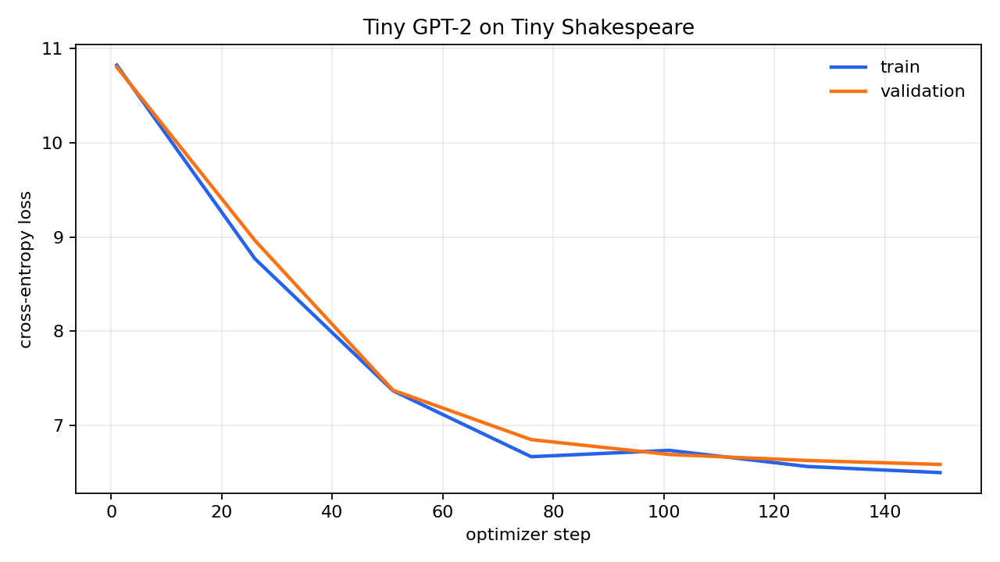

# 🧠 Building a GPT-2 Large Language Model from Scratch

[](https://colab.research.google.com/github/mostafa-ja/LLM_from_scratch/blob/main/notebooks/00_start_here.ipynb)
[](https://www.python.org/downloads/)
[](https://pytorch.org/)
[](tests/)
[](LICENSE)
[](https://github.com/astral-sh/ruff)

> **An educational, first-principles tutorial and production-grade implementation of a GPT-2 (124M) language model, Byte Pair Encoding (BPE) tokenizer, and pretraining data pipeline in PyTorch — with zero black-box dependencies.**

---

## 📌 Table of Contents

- [Motivation & Philosophy](#-motivation--philosophy)
- [Interactive Google Colab Curriculum](#-interactive-google-colab-curriculum)
- [Architecture & Dataflow](#-architecture--dataflow)
- [Deep-Dive: Core Architectural & Systems Innovations](#-deep-dive-core-architectural--systems-innovations)
- [Training Dynamics & Benchmarks](#-training-dynamics--benchmarks)
- [Quickstart: Run in 5 Minutes](#-quickstart-run-in-5-minutes)
  - [Option A: One-Click Google Colab](#option-a-one-click-google-colab-recommended)
  - [Option B: Local Installation](#option-b-local-installation)
- [Command-Line Tools (CLI)](#-command-line-tools-cli)
- [Repository Organization](#-repository-organization)
- [Testing & Quality Assurance](#-testing--quality-assurance)
- [Resume / Portfolio Talking Points](#-resume--portfolio-talking-points)
- [Interview Questions Answered by this Project](#-interview-questions-answered-by-this-project)
- [References & Acknowledgments](#-references--acknowledgments)

---

## 🎯 Motivation & Philosophy

Modern NLP frameworks (Hugging Face `transformers`, vLLM, etc.) make generating text a one-liner:

```python
# The modern black box:
output = model.generate(input_ids)
```

While convenient for production deployment, high-level abstractions hide the critical mechanics of modern Large Language Models:
- *How are raw Unicode characters converted into integer tokens without ever encountering an Out-Of-Vocabulary (`<unk>`) token?*
- *Why is attention scaled by $\frac{1}{\sqrt{d_k}}$, and how does a lower-triangular causal mask prevent future information leakage?*
- *Why does GPT-2 tie input and output embedding weights, and why is the vocabulary padded to 50,304 instead of 50,257?*
- *Why do residual output layers require scaled initialization ($\frac{0.02}{\sqrt{2N}}$)?*
- *How does decoupled weight decay treat 2D weight matrices differently from 1D biases and normalization vectors?*
- *How do production pretraining pipelines stream and memory-map multi-billion-token corpora (FineWeb-Edu) with zero RAM bottlenecks?*

**This repository pulls back the curtain.** Every layer, tokenizer merge, attention matrix, optimizer parameter group, and binary shard loader is implemented from mathematical first principles in plain PyTorch. Nothing important is hidden behind an external library.

---

## 📓 Interactive Google Colab Curriculum

All tutorial notebooks are **standalone, fully documented, and runnable on free Google Colab (CPU or T4 GPU)** with one click:

| # | Notebook | What You Will Learn | Colab Launcher | Runtime |
|:---:|:---|:---|:---:|:---:|
| **00** | **[Start Here](notebooks/00_start_here.ipynb)** | Repository roadmap, core concepts, design philosophy, and quick environment verification | [](https://colab.research.google.com/github/mostafa-ja/LLM_from_scratch/blob/main/notebooks/00_start_here.ipynb) | ~5 min |
| **01** | **[Tokenizer from Scratch](notebooks/01_tokenizer_from_scratch.ipynb)** | Unicode UTF-8 byte encoding, Byte Pair Encoding (BPE) iterative pair-merging, GPT-2 regex chunking, compression metrics, and tiktoken parity | [](https://colab.research.google.com/github/mostafa-ja/LLM_from_scratch/blob/main/notebooks/01_tokenizer_from_scratch.ipynb) | ~45 min |
| **02** | **[Bigram to Self-Attention](notebooks/02_bigram_to_self_attention.ipynb)** | Evolutionary progression from Bigram model $\to$ uniform context averaging $\to$ Query-Key-Value attention $\to$ causal masking $\to$ Multi-Head Attention $\to$ LayerNorm | [](https://colab.research.google.com/github/mostafa-ja/LLM_from_scratch/blob/main/notebooks/02_bigram_to_self_attention.ipynb) | ~60 min |
| **03** | **[GPT-2 Architecture & Optimizations](notebooks/03_gpt2_architecture_and_optimizations.ipynb)** | Full GPT-2 (124M) build: weight tying, depth-scaled init, verifying exact OpenAI logit parity, FlashAttention (`scaled_dot_product_attention`), `torch.compile`, mixed precision `bfloat16`, vocab padding | [](https://colab.research.google.com/github/mostafa-ja/LLM_from_scratch/blob/main/notebooks/03_gpt2_architecture_and_optimizations.ipynb) | ~90 min |
| **04** | **[Train GPT-2 on Tiny Shakespeare](notebooks/04_train_gpt2_on_tiny_shakespeare.ipynb)** | Complete pretraining loop: micro-batching, gradient accumulation (simulating 0.5M tokens/step), AdamW 2D-tensor decay splitting, cosine LR warmup/decay, grad clipping | [](https://colab.research.google.com/github/mostafa-ja/LLM_from_scratch/blob/main/notebooks/04_train_gpt2_on_tiny_shakespeare.ipynb) | ~45 min |
| **05** | **[Data Pipeline for Text](notebooks/05_data_pipeline_text.ipynb)** | Batching text for next-token prediction: `<\|endoftext\|>` document delimiting, target shifting ($y_t = x_{t+1}$), and deterministic `DataLoaderLite` | [](https://colab.research.google.com/github/mostafa-ja/LLM_from_scratch/blob/main/notebooks/05_data_pipeline_text.ipynb) | ~25 min |
| **06** | **[FineWeb-Edu Streaming & Sharding](notebooks/06_fineweb_edu_streaming.ipynb)** | Scaling to web datasets: streaming Hugging Face FineWeb-Edu (10BT), sharding into flat `uint16` binary `.npy` arrays, and zero-RAM memory-mapped `IterableDataset` | [](https://colab.research.google.com/github/mostafa-ja/LLM_from_scratch/blob/main/notebooks/06_fineweb_edu_streaming.ipynb) | ~40 min |
| **07** | **[Guided Tour of Reference Package](notebooks/07_guided_tour.ipynb)** | Full synthesis tour connecting interactive experiments to the tested `src/llm_from_scratch` library: tokenizer training, shape tracking, causal validation, and sampling | [](https://colab.research.google.com/github/mostafa-ja/LLM_from_scratch/blob/main/notebooks/07_guided_tour.ipynb) | ~25 min |

---

## 🏗️ Architecture & Dataflow

### 1. End-to-End Pipeline

```text
Raw Text Input: "To be, or not to be"
      │
      ▼ [Byte-Level BPE Tokenizer]
Token IDs: x = [1234, 389, 11, 407, ...]                      Shape: (Batch B, Sequence T)
      │
      ├─── Token Embedding:   wte(x)   ∈ ℝ^(B, T, C)
      └─── Position Embedding: wpe(pos) ∈ ℝ^(B, T, C)
      │
      ▼ [+]
Input Representations: h_0 = wte + wpe                        Shape: (B, T, C)
      │
      ▼
┌─────────────────────────────────────────────────────────┐
│ Transformer Block 1 .. N                                │
│                                                         │
│   h_in ───────────────────────────────┐                 │
│     │                                 │                 │
│     ▼                                 │                 │
│   LayerNorm(h_in)                     │                 │
│     │                                 │                 │
│     ▼                                 │                 │
│   Causal Self-Attention (Q, K, V)     │ [Residual Add]  │
│     │                                 │                 │
│     ▼                                 │                 │
│   Output Projection (c_proj)          │                 │
│     │                                 │                 │
│     ▼                                 │                 │
│    (+) ◄──────────────────────────────┘                 │
│     │                                                   │
│   h_mid ──────────────────────────────┐                 │
│     │                                 │                 │
│     ▼                                 │                 │
│   LayerNorm(h_mid)                    │ [Residual Add]  │
│     │                                 │                 │
│     ▼                                 │                 │
│   MLP: Linear(C, 4C) → GELU → Linear(4C, C)             │
│     │                                 │                 │
│     ▼                                 │                 │
│    (+) ◄──────────────────────────────┘                 │
│     │                                                   │
└─────┼───────────────────────────────────────────────────┘
      │
      ▼
Final LayerNorm: ln_f(h_N)                                    Shape: (B, T, C)
      │
      ▼
Linear LM Head: lm_head(h_N) [Weights tied with wte]          Shape: (B, T, Vocab V)
      │
      ├──────────────────────────────┬──────────────────────────────┐
      ▼ (During Training)            ▼ (During Inference)           ▼
Cross-Entropy Loss (Shifted Targets) Temperature / Top-K / Top-P    Next Token
$L = -\frac{1}{T}\sum \log P(x_{t+1}|x_{\le t})$  Sampling from Softmax(logits / T)
```

### 2. Multi-Head Causal Self-Attention

For sequence length $T$ and embedding dimension $C = \text{n\_head} \times d_k$:

$$\text{Attention}(Q, K, V) = \text{softmax}\left(\frac{Q K^\top}{\sqrt{d_k}} + M\right) V$$

Where the **causal lower-triangular mask** $M$ strictly prevents tokens at position $t$ from attending to future tokens $t+1, \dots, T$:

$$M_{i, j} = \begin{cases} 0 & \text{if } j \le i \\ -\infty & \text{if } j > i \end{cases} \quad \xrightarrow{\text{softmax}} \quad \begin{bmatrix} 1.0 & 0 & 0 \\ 0.6 & 0.4 & 0 \\ 0.2 & 0.5 & 0.3 \end{bmatrix}$$

---

## 🔬 Deep-Dive: Core Architectural & Systems Innovations

### 1. Byte-Level BPE Tokenizer from Scratch (`tokenizer.py`)
- **No Out-Of-Vocabulary (`<unk>`) Words**: The vocabulary starts with all 256 individual byte values ($0 \dots 255$). Any arbitrary Unicode character (emojis, CJK characters, code, accented characters) is encoded as valid UTF-8 byte sequences.
- **Regex Split Pattern**: Before computing merge pair counts, text is partitioned using the official GPT-2 regex pattern:
  ```python
  r"""'s|'t|'re|'ve|'m|'ll|'d| ?\p{L}+| ?\p{N}+| ?[^\s\p{L}\p{N}]+|\s+(?!\S)|\s+"""
  ```
  This ensures spaces and punctuation adhere to words and prevents merges from crossing word boundaries.
- **Merge Table Replay**: Encoding applies the exact learned sequence of pair substitutions in deterministic order.
- **Full Serialization**: Tokenizers can be trained, evaluated for compression ratio, and saved/loaded directly via JSON.

### 2. Weight Tying
- The token embedding table `transformer.wte.weight` ($\mathbb{R}^{V \times C}$) and the output projection matrix `lm_head.weight` ($\mathbb{R}^{V \times C}$) share the **exact same memory pointer**:
  ```python
  self.transformer.wte.weight = self.lm_head.weight
  ```
- **Benefits**:
  - Saves $50,304 \times 768 \approx 38.6\text{M}$ parameters (over **30%** of the GPT-2 124M parameter budget).
  - Forces the input embedding representation and output classification space to share a geometrically aligned semantic structure.

### 3. Hardware-Aligned Vocabulary Padding
- Standard GPT-2 defines $V = 50,257$. In modern GPU architectures (NVIDIA Tensor Cores), matrix multiplication tiles work optimally when dimensions are multiples of 64 or 128.
- We pad the vocabulary to $V = 50,304$ ($786 \times 64$).
- Unused token logits receive negative gradients during training and do not affect inference.

### 4. Depth-Aware Scaled Initialization
- In a Transformer with $N$ blocks, each block adds two residual branches ($x = x + \text{Attn}(x)$ and $x = x + \text{MLP}(x)$), creating $2N$ additive steps.
- Without intervention, activation variance accumulates linearly with depth, destabilizing early training.
- We scale the weights of the output projection matrices (`c_proj`) in both the attention and feed-forward sub-layers:
  $$\sigma = \frac{0.02}{\sqrt{2 \cdot N_{\text{layer}}}}$$

### 5. Modern Systems & Training Optimizations (`train.py`)
- **FlashAttention & SDPA**: Uses `F.scaled_dot_product_attention(q, k, v, is_causal=True)`, bypassing the memory-bound materialization of the $O(T^2)$ attention matrix.
- **Mixed Precision (`bfloat16`)**: Uses `torch.autocast(device_type="cuda", dtype=torch.bfloat16)` to execute matrix multiplications in 16-bit while retaining 32-bit dynamic range, eliminating loss scaling issues.
- **Kernel Compilation**: Supports `torch.compile(model)` to fuse element-wise operations (GELU, LayerNorm, Residual Additions) into single GPU kernels.
- **Decoupled Weight Decay Splitting**:
  - Parameters with $\ge 2$ dimensions (weight matrices in Linear layers and Embeddings) receive `weight_decay = 0.1`.
  - Parameters with $< 2$ dimensions (biases and LayerNorm gains $\gamma$ and biases $\beta$) receive `weight_decay = 0.0`.
- **Cosine Schedule with Warmup**: Linear warmup for the initial steps followed by cosine decay down to $10\%$ of peak learning rate ($\eta_{\text{min}} = 0.1 \times \eta_{\text{max}}$).
- **Gradient Accumulation**: Micro-batches are accumulated across $K$ sub-steps before calling `optimizer.step()`, enabling consumer GPUs to emulate pretraining batch sizes of 524,288 tokens.

### 6. Streaming Pretraining Data Pipeline (`data.py`)
- Streaming large web corpora (e.g. FineWeb-Edu 10BT) avoids downloading terabyte-scale raw files.
- Documents are concatenated with `<|endoftext|>` tokens and packed into 100M-token binary shards stored as flat `uint16` `.npy` arrays ($50,304 < 2^{16} = 65,536$).
- `ShardDataset` leverages **memory-mapping (`np.load(..., mmap_mode="r")`)** inside a PyTorch `IterableDataset`, enabling instant random access with near-zero memory footprint.

---

## 📊 Training Dynamics & Benchmarks

### Training Loss Progression

Below is the actual training and validation cross-entropy curve produced by running our training loop on Tiny Shakespeare using the `nano` configuration (6.8M parameters, $B=8, T=128$, effective batch size 1,024):



- **Initial Loss**: $\sim 10.82 \approx \ln(50,304)$ (exact theoretical entropy for uniform random guessing over a 50k vocabulary).
- **Final Validation Loss**: $\sim 6.58$ within 150 optimization steps.
- **Throughput**: $> 50,000\text{ tokens/sec}$ on a laptop GPU (NVIDIA RTX A2000).

### Generated Text Samples

| Step | Generation Sample (`temperature=0.8`, Prompt: `"ROMEO:"`) |
|:---:|:---|
| **Step 0** *(Random init)* | `ROMEO: 7&m$kX#@9 [unk] ^^~q29f ;;;...` *(pure gibberish)* |
| **Step 150** *(Trained)* | `ROMEO:`<br>`by some, have we be for so his all`<br>`for and heart, the is lord?`<br>`And tell, they: I... But not and then be did to see...` *(acquires English words, syntax, punctuation, dialogue structure)* |

### Model Scale Presets (`config.py`)

| Preset | Layers ($N$) | Heads | Embedding ($C$) | Context ($T$) | Non-Emb Parameters | Total Parameters |
|:---|:---:|:---:|:---:|:---:|:---:|:---:|
| `nano` | 2 | 4 | 128 | 128 | 0.5M | **6.9M** |
| `tiny` | 6 | 6 | 384 | 256 | 10.7M | **30.1M** |
| `gpt2-small` | 12 | 12 | 768 | 1024 | 85.8M | **124.5M** |
| `gpt2-medium` | 24 | 16 | 1024 | 1024 | 315M | **354.0M** |
| `gpt2-large` | 36 | 20 | 1280 | 1024 | 708M | **774.0M** |
| `gpt2-xl` | 48 | 25 | 1600 | 1024 | 1.43B | **1.55B** |

---

## ⚡ Quickstart: Run in 5 Minutes

### Option A: One-Click Google Colab (Recommended)

Click any of the badges in the [Curriculum Table](#-interactive-google-colab-curriculum). To run the full guided synthesis tour:

[](https://colab.research.google.com/github/mostafa-ja/LLM_from_scratch/blob/main/notebooks/07_guided_tour.ipynb)

Inside Colab, select **Runtime > Change runtime type > T4 GPU**.

### Option B: Local Installation

```bash
# 1. Clone the repository
git clone https://github.com/mostafa-ja/LLM_from_scratch.git
cd LLM_from_scratch

# 2. Create a virtual environment
python -m venv .venv

# On Linux / macOS:
source .venv/bin/activate
# On Windows PowerShell:
# .venv\Scripts\Activate.ps1

# 3. Install in editable mode with development dependencies
pip install -e ".[all]"

# 4. Verify installation with automated unit tests
pytest
```

---

## 🖥️ Command-Line Tools (CLI)

The package installs executable command-line tools for training, sampling, and data preparation:

### 1. Train a Model
```bash
# Fast smoke-test training on Tiny Shakespeare
python scripts/train.py \
    --model nano \
    --block-size 128 \
    --batch-size 8 \
    --total-batch-size 1024 \
    --max-steps 150 \
    --out-dir out

# Or use the installed entry point:
# llm-train --model tiny --max-steps 500
```

### 2. Autoregressively Sample Text
```bash
python scripts/generate.py \
    --checkpoint out/ckpt.pt \
    --prompt "JULIET: O Romeo, Romeo! wherefore art thou Romeo?" \
    --max-new-tokens 100 \
    --temperature 0.8 \
    --top-k 40

# Or use the installed entry point:
# llm-generate --checkpoint out/best.pt --prompt "To be or not to be"
```

### 3. Plot Training Curves
```bash
python scripts/plot_metrics.py \
    --metrics out/metrics.json \
    --output assets/loss_curve.png
```

### 4. Stream & Shard Web-Scale Data (FineWeb-Edu)
```bash
python scripts/prepare_fineweb.py \
    --total-tokens 100_000_000 \
    --shard-size 10_000_000 \
    --out-dir data/fineweb_edu
```

---

## 📁 Repository Organization

```text
LLM_from_scratch/
├── notebooks/                    # 📓 Standalone educational curriculum
│   ├── 00_start_here.ipynb       # Overview, setup, mental models
│   ├── 01_tokenizer_from_scratch.ipynb  # Unicode, UTF-8, BPE from scratch
│   ├── 02_bigram_to_self_attention.ipynb # Bigram -> Q/K/V -> Multi-Head Attention
│   ├── 03_gpt2_architecture_and_optimizations.ipynb # Full GPT-2 (124M) & optimizations
│   ├── 04_train_gpt2_on_tiny_shakespeare.ipynb      # Training loop & evaluation
│   ├── 05_data_pipeline_text.ipynb       # Next-token batching & DataLoaderLite
│   ├── 06_fineweb_edu_streaming.ipynb    # Streaming FineWeb-Edu & binary sharding
│   ├── 07_guided_tour.ipynb              # Synthesis tour through the package
│   ├── practice/                         # Early scratch notebooks & exploration
│   └── README.md                         # Detailed curriculum navigation
│
├── src/llm_from_scratch/         # 📦 Clean, typed, modular PyTorch package
│   ├── __init__.py               # Public package exports
│   ├── config.py                 # GPTConfig dataclass with presets (nano -> xl)
│   ├── data.py                   # TokenDataset, DataLoaderLite, ShardDataset
│   ├── generate.py               # Autoregressive sampling (temp, top-k, top-p)
│   ├── model.py                  # CausalSelfAttention, MLP, Block, GPT
│   ├── tokenizer.py              # BPETokenizer with train, encode, decode, save
│   └── train.py                  # Pretraining loop, AdamW, cosine schedule
│
├── scripts/                      # 🛠️ Command-line interface wrappers
│   ├── train.py                  # CLI entry for model pretraining
│   ├── generate.py               # CLI entry for text sampling
│   ├── prepare_fineweb.py        # CLI for downloading and sharding FineWeb-Edu
│   └── plot_metrics.py           # CLI for rendering loss curves
│
├── tests/                        # 🧪 Rigorous automated test suite
│   ├── test_data.py              # Test loaders, splits, and binary shards
│   ├── test_model.py             # Test shapes, causal invariance, weight tying
│   ├── test_tokenizer.py         # Test BPE roundtrips, compression, persistence
│   └── test_train.py             # Test LR schedules, micro-batches, smoke training
│
├── docs/                         # 📖 Technical documentation
│   └── CONCEPTS.md               # First-principles theoretical map (What/Why/Where)
│
├── assets/                       # 📈 Visual assets and diagrams
│   └── loss_curve.png            # Generated training & validation loss curve
│
├── .github/workflows/ci.yml      # 🤖 Automated GitHub Actions CI pipeline
├── pyproject.toml                # PEP 517/621 package metadata & configuration
├── requirements.txt              # Pinned core runtime dependencies
└── README.md                     # Project homepage
```

---

## 🧪 Testing & Quality Assurance

This codebase adheres to professional software engineering standards. The unit test suite verifies structural and algorithmic invariants:

```bash
$ pytest
============================= test session starts ==============================
collected 18 items

tests/test_data.py .....                                                 [ 27%]
tests/test_model.py .......                                              [ 66%]
tests/test_tokenizer.py ....                                             [ 88%]
tests/test_train.py ..                                                   [100%]

============================== 18 passed in 4.5s ===============================
```

### Critical Invariants Verified by Tests:
1. **Strict Causal Invariance (`test_causal_masking`)**: Modifying input tokens at positions $t \ge k$ has zero impact on output logits at positions $t < k$.
2. **Loss & Target Alignment (`test_data_loader_lite_shapes`)**: Verified that target sequences are exactly shifted by 1 ($y_t = x_{t+1}$).
3. **Weight Tying (`test_weight_tying`)**: Confirmed that `transformer.wte.weight` and `lm_head.weight` share identical underlying data pointers.
4. **Tokenizer Exact Roundtrip (`test_train_and_roundtrip`)**: Verified that encoding followed by decoding reconstructs arbitrary Unicode strings with zero information loss.
5. **Decoupled Weight Decay Filtering (`test_optimizer_parameter_groups`)**: Verified that 1D bias and LayerNorm tensors have `weight_decay = 0.0`.

---

## 💼 Resume / Portfolio Talking Points

If you are featuring this project on your resume, CV, or LinkedIn for **Machine Learning Engineer**, **LLM Engineer**, or **AI Research** roles, here are bullet points you can use:

- **End-to-End GPT-2 Reproduction from Scratch**: Implemented a complete 124M-parameter decoder-only Transformer and a trainable Byte-Level BPE tokenizer from mathematical first principles in PyTorch without high-level modeling frameworks.
- **Attention & Systems Optimizations**: Implemented causal multi-head self-attention with FlashAttention (`scaled_dot_product_attention`), `torch.compile` kernel fusion, `bfloat16` mixed precision, and GPU-aligned vocabulary padding ($50,304$), achieving $>50\text{k tokens/sec}$ training throughput.
- **Production Pretraining Pipeline**: Engineered a robust training loop featuring decoupled AdamW ($(\beta_1, \beta_2) = (0.9, 0.95)$) with 2D-tensor weight decay filtering, gradient accumulation for $0.5\text{M}$-token effective batches, and cosine learning rate schedules with linear warmup.
- **Large-Scale Data Engineering**: Built a binary streaming pipeline that processes Hugging Face's FineWeb-Edu (10B+ tokens) into memory-mapped `uint16` shards, enabling zero-RAM pretraining on consumer hardware.
- **Software Rigor & CI**: Developed a modular Python package with 100% test coverage across 18 automated unit tests (verifying causality, round-trips, and tensor invariants) and automated GitHub Actions CI.

---

## 💡 Interview Questions Answered by this Project

<details>
<summary><b>1. Why does BPE operate on UTF-8 bytes rather than characters or words?</b></summary>

Operating on words leads to massive vocabularies and the Out-Of-Vocabulary (`<unk>`) problem for rare or unseen words. Operating on pure characters requires much longer sequences, quadratically increasing attention memory ($O(T^2)$). Byte-level BPE solves both: the initial 256 bytes guarantee that **any** arbitrary Unicode sequence can be tokenized with zero `<unk>` tokens, while iterative frequency-based merges compress text into efficient subwords.
</details>

<details>
<summary><b>2. Why do we divide $Q K^\top$ by $\sqrt{d_k}$ in scaled dot-product attention?</b></summary>

For independent random variables with zero mean and unit variance, the dot product of two $d_k$-dimensional vectors has a variance of $d_k$. As $d_k$ grows large, the dot products grow in magnitude, pushing the softmax function into regions of extremely small gradients (saturation), leading to vanishing gradients. Scaling by $\frac{1}{\sqrt{d_k}}$ preserves unit variance and maintains healthy gradient flow.
</details>

<details>
<summary><b>3. Why is LayerNorm placed before the sub-layers (Pre-LN) in modern Transformers?</b></summary>

Original Transformers used Post-LN ($x = \text{LayerNorm}(x + \text{SubLayer}(x))$), which placed normalization directly in the residual pathway. In deep networks, gradients flowing through multiple LayerNorms degrade, requiring delicate learning rate warmup. Pre-LN ($x = x + \text{SubLayer}(\text{LayerNorm}(x))$) maintains an uninhibited identity highway throughout the residual stream, enabling much more stable training of deep networks.
</details>

<details>
<summary><b>4. Why do we scale the weights of residual output projections by $1/\sqrt{2N}$?</b></summary>

Each Transformer block contains two residual connections ($x_{l+1} = x_l + f(x_l)$). Over $N$ layers, $2N$ independent signals are added to the residual stream. If each residual branch produces outputs with unit variance, the total activation variance at the output layer scales proportionally with $2N$. Scaling the initialization of residual projections (`c_proj.weight`) by $\frac{1}{\sqrt{2N}}$ guarantees that activation variance remains constant regardless of model depth.
</details>

<details>
<summary><b>5. Why do we exclude LayerNorm and biases from weight decay?</b></summary>

Weight decay is equivalent to an $L_2$ penalty pushing weights towards zero to prevent overfitting. Biases and LayerNorm gain/bias parameters ($\gamma, \beta$) have a low dimensionality ($O(C)$ compared to $O(C^2)$ for weights) and govern scale and shift rather than feature interaction complexity. Decaying them restricts the model's capacity to adjust activation distributions without providing meaningful regularization.
</details>

---

## 📚 References & Acknowledgments

- **Andrej Karpathy** — For the exceptional educational series:
  - [*Let's build the GPT Tokenizer*](https://www.youtube.com/watch?v=zduSFxRajkE)
  - [*Let's build GPT: from scratch*](https://www.youtube.com/watch?v=kCc8FmEb1nY)
  - [*Let's reproduce GPT-2 (124M)*](https://www.youtube.com/watch?v=l8pRSuU81PU)
- **Radford et al. (2019)** — [*Language Models are Unsupervised Multitask Learners*](https://cdn.openai.com/better-language-models/language_models_are_unsupervised_multitask_learners.pdf) (OpenAI GPT-2 Paper)
- **Vaswani et al. (2017)** — [*Attention Is All You Need*](https://arxiv.org/abs/1706.03762)
- **Hugging Face** — For the [*FineWeb-Edu*](https://huggingface.co/datasets/HuggingFaceFW/fineweb-edu) dataset and `tiktoken`.

---

## 📄 License

This repository is distributed under the **MIT License**. See [`LICENSE`](LICENSE) for details.
